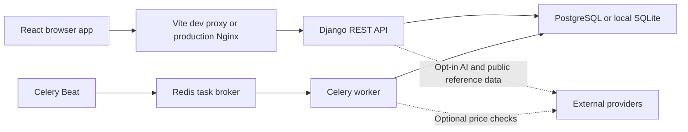

# FinDash architecture

FinDash is a Vite and React single-page app backed by Django REST Framework. Vite proxies `/api/` in development. In production, Nginx serves the frontend and forwards API, admin, and Django static requests to Gunicorn. The normal deployment uses one browser origin for both apps.

## Code map

| Location | Responsibility |
| --- | --- |
| `frontend/src/pages` and `components` | React Router pages and reusable UI. Recharts and Chart.js render charts from API responses. |
| `frontend/src/api.js` | Shared Axios client, bearer token handling, and refresh coordination. |
| `backend/backend` | Django settings, top-level routing, Celery initialization, health, and schema integration. |
| `backend/api/views` | Authentication, permissions, request validation, and HTTP responses. |
| `backend/api/services` | Financial calculations, statement parsing, external adapters, and report generation. |
| `backend/api/models.py` and `migrations` | Persistent entities, ledger entries, database constraints, and schema changes. |
| `backend/api/tasks.py` | Background checks for notifications and expired refresh tokens. |
| `backend/api/openapi_contracts.py` | Schema metadata for endpoints whose requests or responses need extra documentation. |

## Data and trust boundaries

- Authenticated API views derive account identity from the JWT and scope queries to that account. Report tokens and saved scenario IDs are also owner-bound.
- Financial calculations run on the server using ledger records. Goal contributions and virtual trades have separate histories. Cash flow and goal scenarios are estimates.
- Statement imports validate PDF or CSV input, produce a preview, then commit selected rows in an atomic transaction. Provider-based extraction and AI categorization require opt-in.
- Copilot validates the model’s tool choices and calculates the answer from read-only, owner-scoped data. Reports can opt into qualitative AI commentary. Browser clients render provider content as text or validated structured data.
- Celery Beat schedules work through Redis. Workers generate deduplicated in-app notifications. The browser polls the authenticated inbox over HTTP.
- PostgreSQL stores application data in containers. Local SQLite supports lightweight development and isolated browser tests. Redis queues tasks and can provide shared rate-limit state.

See the [security notes](../SECURITY.md), [environment reference](environment.md), and [deployment instructions](../README.md#production-deployment).
